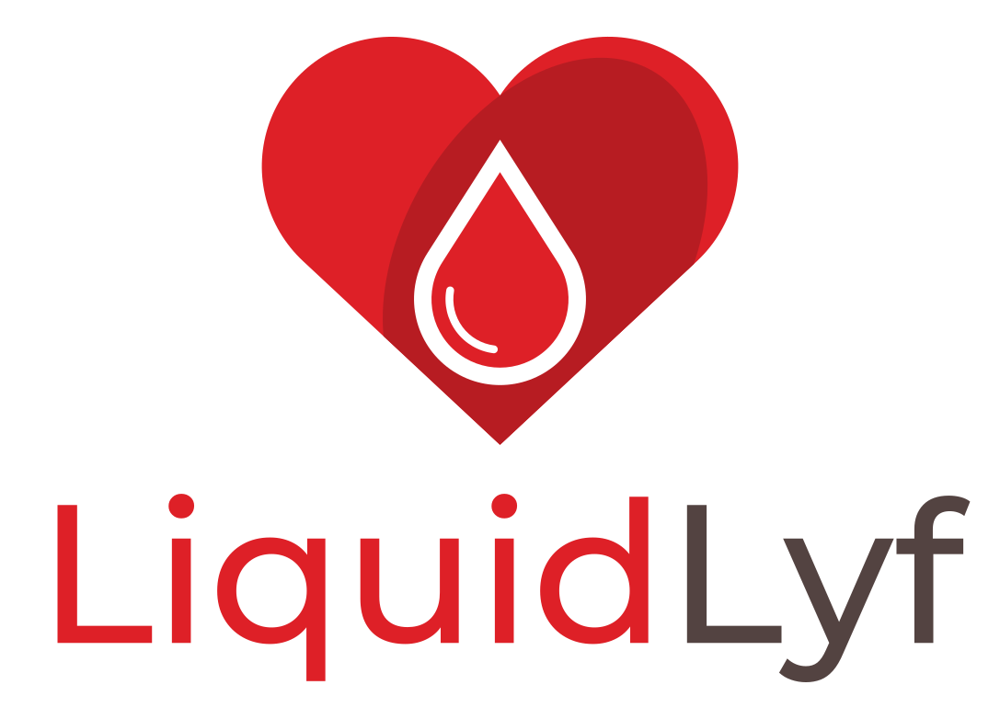
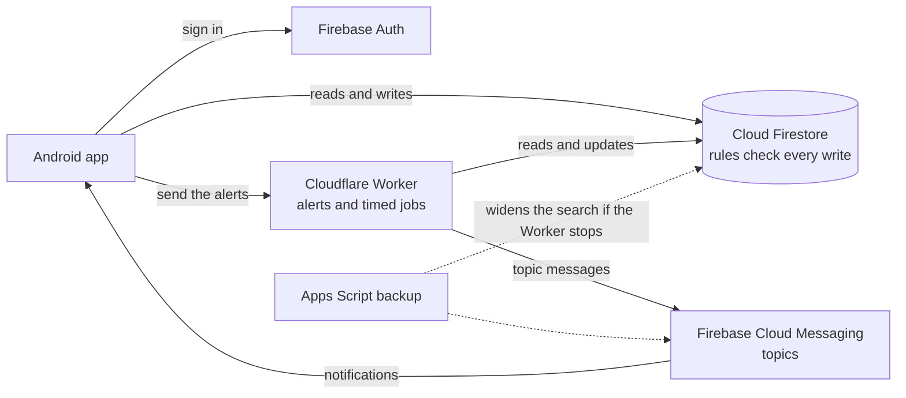

<p align="center">
  <picture>
    <source media="(prefers-color-scheme: dark)" srcset="branding/logo-full-dark.svg">
    
  </picture>
</p>

# LiquidLyf

**A free, privacy-first app that connects blood donors with people who need blood in Bangladesh.**

> 🚧 **Rebuild in progress.** LiquidLyf is being rebuilt from the ground up on the `rebuild` branch.
> There is no release of the new app yet. Follow along, or [help build it](CONTRIBUTING.md).

> 🩸 **Need blood urgently?** Contact your hospital or a licensed blood bank now. GitHub is not an
> emergency channel.

## What it does

The new app is being tested and isn't released yet. It:

- **Alerts the right donors:** a request reaches donors who are eligible, available and have a
  compatible blood group near the hospital. If nobody responds, the search area widens step by step.
- **Lets you search for donors:** find listed donors by blood group and area, and ask them to
  donate, without seeing their phone numbers.
- **Protects phone numbers:** numbers are never listed publicly. A requester sees a donor's number
  only when that donor offers to help, and the donor sees the request's contact only while the offer
  is active.
- **Knows when you can donate:** it counts the rest period after each donation, and reminds you when
  you can donate again.
- **Keeps your record:** your donation history, your impact and your badges, on your profile.
- **Fights scams:** a clear "never pay for blood" rule, a warning when a request mentions money,
  report and block buttons, and volunteer moderators.
- **Speaks Bangla:** Bangla and English. The Bangla translation is being finished.
- **Lets you leave:** delete your account and its data in the app, or by email.
- **Costs nothing:** free for everyone, with no ads. It runs on free plans of Firebase and Cloudflare.

<!-- Screenshots come back at v1.0 (the maintainer, 16 Nov 2026), re-taken from the release build. -->

## Download

Not available yet. When v1.0 is ready, the signed APK will be on
[GitHub Releases](https://github.com/liquidlyf/LiquidLyf/releases) and at
[liquidlyf.github.io](https://liquidlyf.github.io), with a Bangla install guide.

## For developers

You can run the app on your own computer in about 15 minutes, **without a Firebase account**: the
`demo` build uses the local Firebase emulators with made-up sample data.

```bash
git clone https://github.com/liquidlyf/LiquidLyf.git && cd LiquidLyf
git switch rebuild
cd firebase && npm ci && npm run emulators          # terminal 1: local backend
./gradlew installDemoDebug                          # terminal 2, from the repo root
```

The full steps, the code rules and how to send a pull request are in [CONTRIBUTING.md](CONTRIBUTING.md).

**Built with:** Kotlin, Jetpack Compose and Material 3 · Cloud Firestore with tested security rules ·
Firebase Cloud Messaging · a Cloudflare Worker (TypeScript) for alerts and timed jobs · GitHub Actions.



There are no Cloud Functions and no paid services. [How the app is built](docs/architecture.md)
explains the parts and the rules every pull request follows.

| Folder | What's inside |
|---|---|
| `app/` | The Android app |
| `firebase/` | Firestore security rules, rules tests and sample data for the emulators |
| `backend/` | The Cloudflare Worker, its Google Apps Script backup, the maintainers' admin scripts, and data shared with the app |
| `docs/` | [How the app is built](docs/architecture.md) and [decision records](docs/adr/) |
| `branding/` | The logo (not open-licensed; see [TRADEMARKS.md](TRADEMARKS.md)) |

## Community

- **Questions and ideas:** [Discussions](../../discussions)
- **Bugs and tasks:** [Issues](../../issues). Look for `good first issue`.
- **Help with the app, or your account:** [SUPPORT.md](SUPPORT.md)
- **Security problems:** please report privately, as in [SECURITY.md](SECURITY.md)
- **How the project is run:** [GOVERNANCE.md](GOVERNANCE.md) · [MAINTAINERS.md](MAINTAINERS.md)
- Everyone follows our [Code of Conduct](CODE_OF_CONDUCT.md).

Contact: **liquidlyf@gmail.com**

## Licence

LiquidLyf is free software under the **GNU Affero General Public License v3.0 or later**
([LICENSE](LICENSE)), with an additional permission for Google Play services and Firebase libraries.
Modified versions must keep the credit "Based on LiquidLyf — https://github.com/liquidlyf/LiquidLyf"
on their About screen (AGPL section 7(b)). Documentation in `docs/` is CC BY 4.0. The details are in
[LICENSING.md](LICENSING.md).

Copyright (C) 2025-2026 The LiquidLyf contributors.

## Trademark

LiquidLyf™ and the LiquidLyf logo are not covered by the licence. If you publish a fork, please give it
your own name, logo and app ID. See [TRADEMARKS.md](TRADEMARKS.md).

## History: university project (v0)

LiquidLyf started in 2025 as a university project: an Android app (Kotlin, XML layouts, Firebase Realtime
Database) for registering donors and posting blood requests. That version is preserved, unchanged, at the
tag [`v0-university`](../../tree/v0-university), with its screenshots and its original MIT licence. It is
no longer maintained, and its app ID `com.azminur.liquidlyf` isn't used by the new app.

The rebuild keeps the name, the idea and the heart-and-drop logo, and starts the code again with a new
design, a new data model and a focus on privacy and safety.
